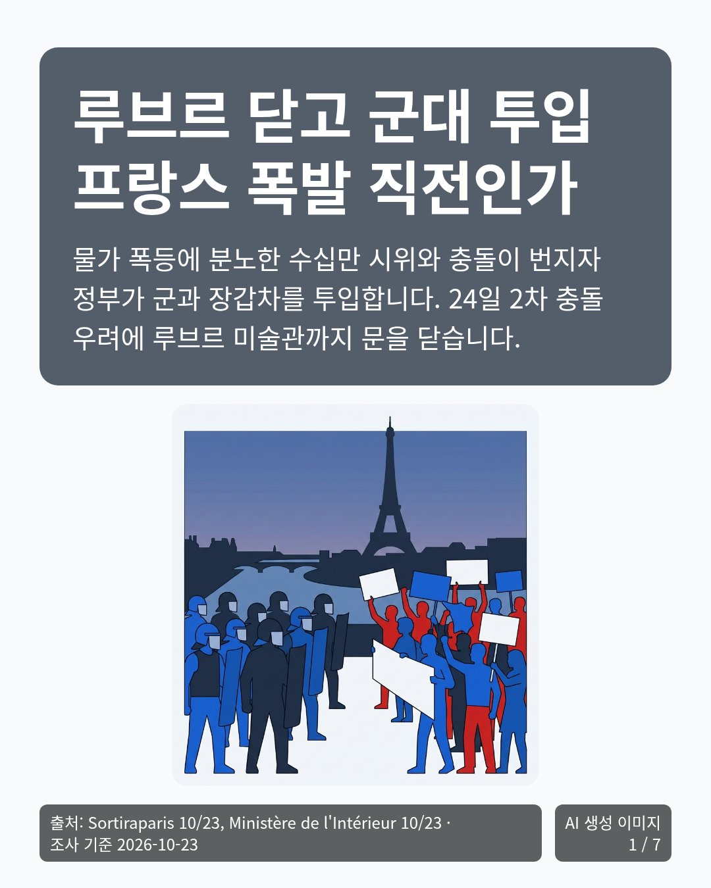
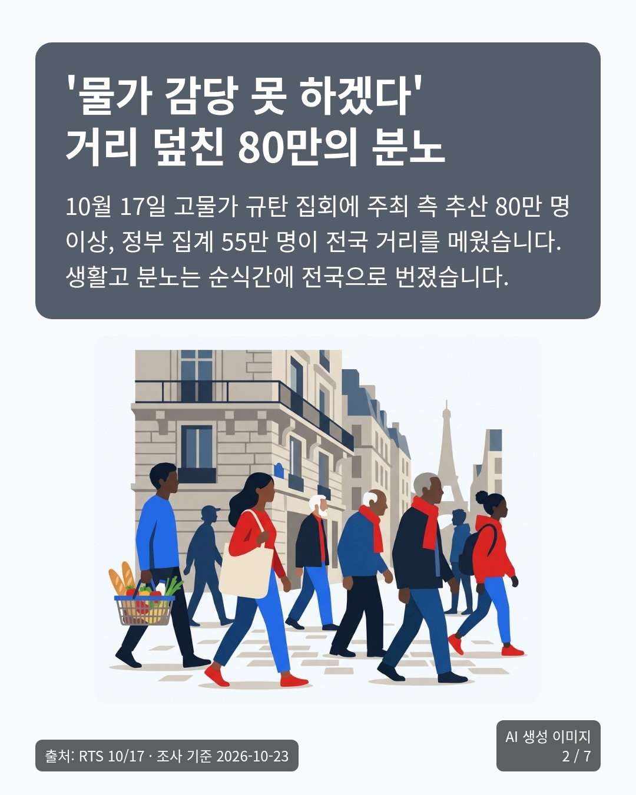
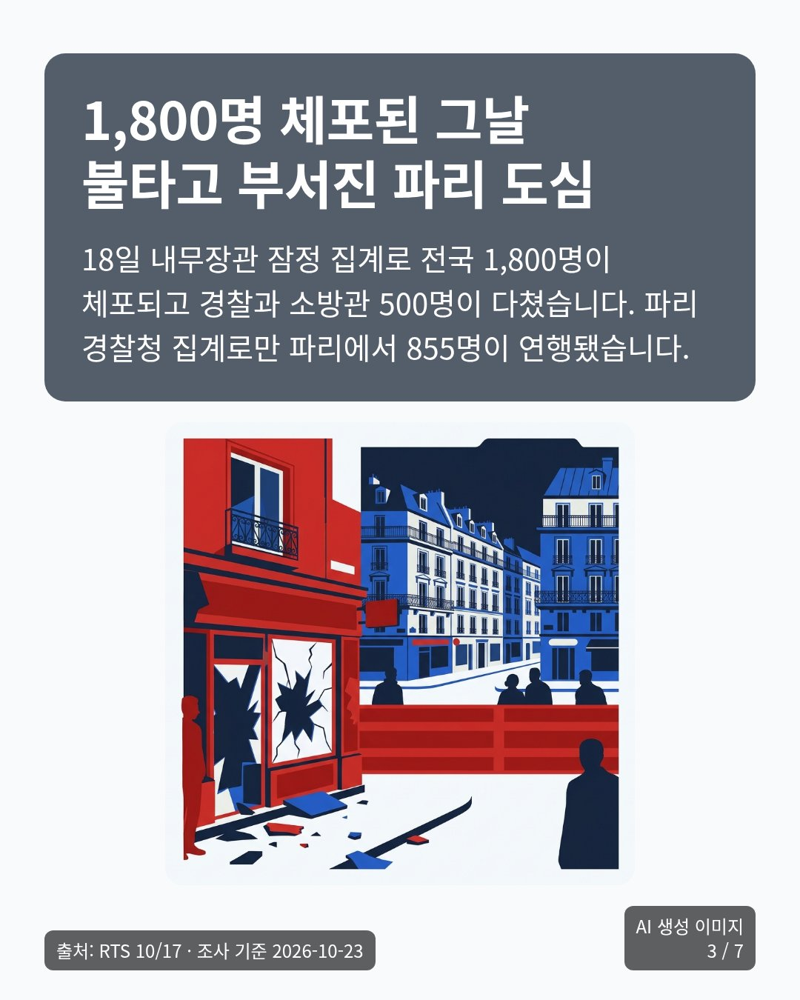
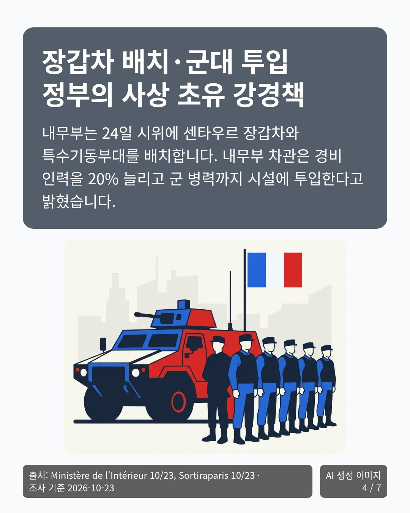
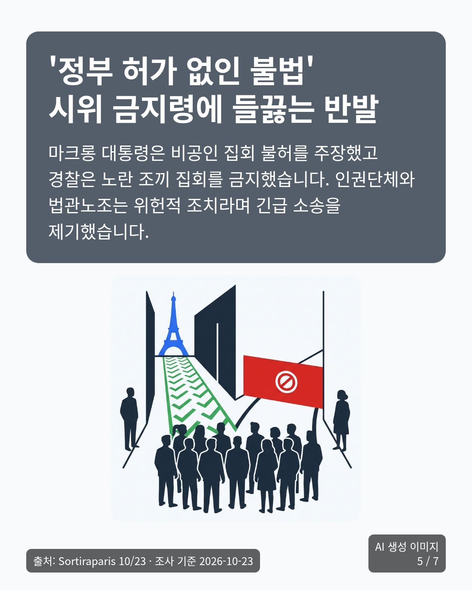
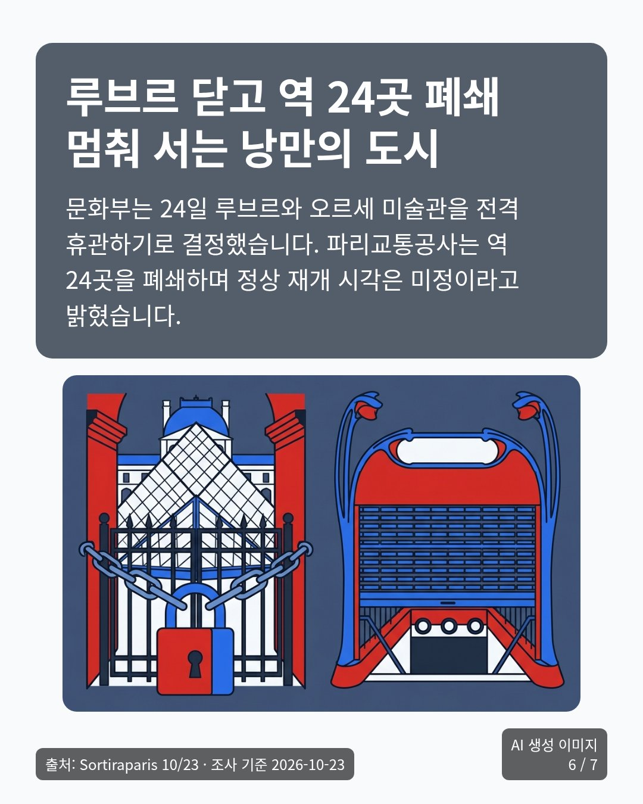
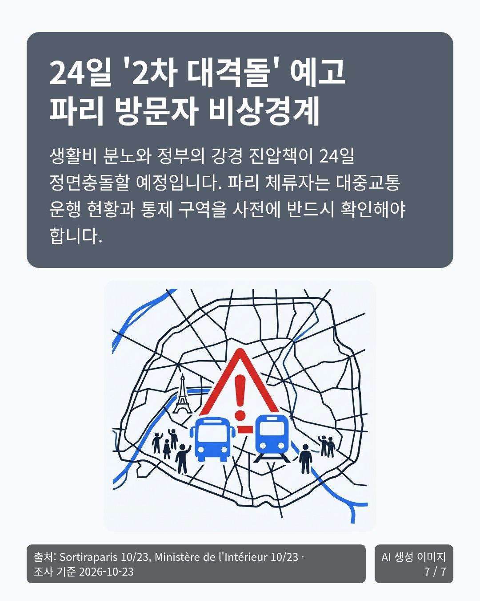

# 카드뉴스 에이전트

👉 **바로 써 보기: https://card-news-agent.onrender.com**

- 처음 열 때 1분쯤 걸릴 수 있어요. 잠자던 서버가 깨어나는 중이에요.
- 카드뉴스는 한 사람(같은 인터넷 주소)이 **하루에 한 편**만 만들 수 있어요.

## 무엇을 하나요?

궁금한 주제를 적으면 요즘 나온 뉴스를 찾아서, 넘겨 보는 그림 카드 여러 장으로 정리해 줘요.

## 이런 카드가 나와요

주제에 「프랑스 시위」 한 마디만 적고, 이 사이트에서 실제로 만든 카드 7장이에요. (2026년 10월 23일)
옆으로 밀어서 넘겨 보세요. 누르면 크게 보여요.

<!-- 칸마다 줄바꿈 없는 공백 줄을 넣어 칸이 그림 폭 아래로 줄지 않게 한다. 그래야 GitHub에서 표가 가로로 스크롤된다. -->
<table><tr>
<td> &nbsp;&nbsp;&nbsp;&nbsp;&nbsp;&nbsp;&nbsp;&nbsp;&nbsp;&nbsp;&nbsp;&nbsp;&nbsp;&nbsp;&nbsp;&nbsp;&nbsp;&nbsp;&nbsp;&nbsp;&nbsp;&nbsp;&nbsp;&nbsp;&nbsp;&nbsp;&nbsp;&nbsp;&nbsp;&nbsp;&nbsp;&nbsp;&nbsp;&nbsp;&nbsp;&nbsp;&nbsp;&nbsp;&nbsp;&nbsp;&nbsp;&nbsp;&nbsp;&nbsp;&nbsp;&nbsp;&nbsp;&nbsp;&nbsp;&nbsp;&nbsp;&nbsp;&nbsp;&nbsp;&nbsp;&nbsp;</td>
<td> &nbsp;&nbsp;&nbsp;&nbsp;&nbsp;&nbsp;&nbsp;&nbsp;&nbsp;&nbsp;&nbsp;&nbsp;&nbsp;&nbsp;&nbsp;&nbsp;&nbsp;&nbsp;&nbsp;&nbsp;&nbsp;&nbsp;&nbsp;&nbsp;&nbsp;&nbsp;&nbsp;&nbsp;&nbsp;&nbsp;&nbsp;&nbsp;&nbsp;&nbsp;&nbsp;&nbsp;&nbsp;&nbsp;&nbsp;&nbsp;&nbsp;&nbsp;&nbsp;&nbsp;&nbsp;&nbsp;&nbsp;&nbsp;&nbsp;&nbsp;&nbsp;&nbsp;&nbsp;&nbsp;&nbsp;&nbsp;</td>
<td> &nbsp;&nbsp;&nbsp;&nbsp;&nbsp;&nbsp;&nbsp;&nbsp;&nbsp;&nbsp;&nbsp;&nbsp;&nbsp;&nbsp;&nbsp;&nbsp;&nbsp;&nbsp;&nbsp;&nbsp;&nbsp;&nbsp;&nbsp;&nbsp;&nbsp;&nbsp;&nbsp;&nbsp;&nbsp;&nbsp;&nbsp;&nbsp;&nbsp;&nbsp;&nbsp;&nbsp;&nbsp;&nbsp;&nbsp;&nbsp;&nbsp;&nbsp;&nbsp;&nbsp;&nbsp;&nbsp;&nbsp;&nbsp;&nbsp;&nbsp;&nbsp;&nbsp;&nbsp;&nbsp;&nbsp;&nbsp;</td>
<td> &nbsp;&nbsp;&nbsp;&nbsp;&nbsp;&nbsp;&nbsp;&nbsp;&nbsp;&nbsp;&nbsp;&nbsp;&nbsp;&nbsp;&nbsp;&nbsp;&nbsp;&nbsp;&nbsp;&nbsp;&nbsp;&nbsp;&nbsp;&nbsp;&nbsp;&nbsp;&nbsp;&nbsp;&nbsp;&nbsp;&nbsp;&nbsp;&nbsp;&nbsp;&nbsp;&nbsp;&nbsp;&nbsp;&nbsp;&nbsp;&nbsp;&nbsp;&nbsp;&nbsp;&nbsp;&nbsp;&nbsp;&nbsp;&nbsp;&nbsp;&nbsp;&nbsp;&nbsp;&nbsp;&nbsp;&nbsp;</td>
<td> &nbsp;&nbsp;&nbsp;&nbsp;&nbsp;&nbsp;&nbsp;&nbsp;&nbsp;&nbsp;&nbsp;&nbsp;&nbsp;&nbsp;&nbsp;&nbsp;&nbsp;&nbsp;&nbsp;&nbsp;&nbsp;&nbsp;&nbsp;&nbsp;&nbsp;&nbsp;&nbsp;&nbsp;&nbsp;&nbsp;&nbsp;&nbsp;&nbsp;&nbsp;&nbsp;&nbsp;&nbsp;&nbsp;&nbsp;&nbsp;&nbsp;&nbsp;&nbsp;&nbsp;&nbsp;&nbsp;&nbsp;&nbsp;&nbsp;&nbsp;&nbsp;&nbsp;&nbsp;&nbsp;&nbsp;&nbsp;</td>
<td> &nbsp;&nbsp;&nbsp;&nbsp;&nbsp;&nbsp;&nbsp;&nbsp;&nbsp;&nbsp;&nbsp;&nbsp;&nbsp;&nbsp;&nbsp;&nbsp;&nbsp;&nbsp;&nbsp;&nbsp;&nbsp;&nbsp;&nbsp;&nbsp;&nbsp;&nbsp;&nbsp;&nbsp;&nbsp;&nbsp;&nbsp;&nbsp;&nbsp;&nbsp;&nbsp;&nbsp;&nbsp;&nbsp;&nbsp;&nbsp;&nbsp;&nbsp;&nbsp;&nbsp;&nbsp;&nbsp;&nbsp;&nbsp;&nbsp;&nbsp;&nbsp;&nbsp;&nbsp;&nbsp;&nbsp;&nbsp;</td>
<td> &nbsp;&nbsp;&nbsp;&nbsp;&nbsp;&nbsp;&nbsp;&nbsp;&nbsp;&nbsp;&nbsp;&nbsp;&nbsp;&nbsp;&nbsp;&nbsp;&nbsp;&nbsp;&nbsp;&nbsp;&nbsp;&nbsp;&nbsp;&nbsp;&nbsp;&nbsp;&nbsp;&nbsp;&nbsp;&nbsp;&nbsp;&nbsp;&nbsp;&nbsp;&nbsp;&nbsp;&nbsp;&nbsp;&nbsp;&nbsp;&nbsp;&nbsp;&nbsp;&nbsp;&nbsp;&nbsp;&nbsp;&nbsp;&nbsp;&nbsp;&nbsp;&nbsp;&nbsp;&nbsp;&nbsp;&nbsp;</td>
</tr></table>

## 이렇게 써요

1. **주제 적기** — 예: `프랑스 시위`. 1~2분 동안 최근 7일 뉴스를 찾아요.
2. **뉴스 고르기** — 찾은 뉴스 중에서 1~3개를 골라요.
3. **질문에 답하기** — 꼭 필요할 때만 물어봐요. 예: 누가 읽을 카드인지.
4. **기획 보기** — 카드마다 제목, 글, 그림 계획이 나와요. 고칠 곳은 적어서 부탁하고, 괜찮으면 「승인」을 눌러요.
5. **카드 완성** — 카드마다 그림을 그리고 글자를 얹어요. 한 장에 15초쯤 걸려요.
6. **살펴보고 고치기** — 글자만, 그림만, 또는 고른 카드만 고칠 수 있어요. 고르지 않은 카드는 그대로예요.
7. **내려받기** — 「최종 승인」을 누르면 카드 그림(PNG), 원고, 출처를 ZIP 하나로 받아요.

## 알아 두면 좋아요

- **멈춘 게 아니에요.** 뉴스를 고르거나 승인을 누를 때까지 앱이 기다리는 거예요.
- **카드마다 출처가 있어요.** 어느 기사에서 가져왔는지 카드 아래에 적혀요.
- **그림은 꼭 눈으로 확인하세요.** AI가 가끔 엉뚱한 나라 건물이나 글자를 그려요. 그럴 땐 그림 장면을 고쳐 적고 「그림 다시 만들기」를 눌러요.
- **다 만들면 바로 내려받으세요.** 무료 서버라 잠들면 만든 카드가 사라져요.
- **문제가 생기면** 화면에 이유와 할 일이 나와요. 대부분 「다시 시도」를 누르면 돼요.

## 더 자세한 문서

| 문서 | 내용 |
|---|---|
| [PRD.md](PRD.md) | 요구사항 |
| [DECISIONS.md](DECISIONS.md) | 무엇을 왜 골랐는지 |
| [API_SPEC.md](API_SPEC.md) | 화면과 서버의 약속 |
| [VALIDATION.md](VALIDATION.md) | 시험 기록과 고친 점 |

모두의연구소 「사용자와 함께 만드는 카드뉴스 에이전트」 실습의 [카드뉴스 워크플로 설계 키트(v5.0.0)](https://github.com/SunCreation/agent-building-practice/tree/v5.0.0/card-news-workflow-kit) PRD로 만들었습니다.
